> **Nota importante**
>
> Este tutorial utiliza ejemplos de comandos, nombres de recursos, URLs y configuraciones que hacen referencia a servicios en la nube (principalmente Azure).
> Debido a la naturaleza de estos servicios, muchos de estos identificadores (como nombres de registros, contenedores, grupos de recursos o direcciones DNS) deben ser **únicos y específicos de cada usuario**.
>
> Por este motivo, **no es posible copiar y ejecutar literalmente todos los comandos tal y como aparecen en el documento**.
> Será necesario que adaptes ciertos valores (nombres, rutas, URLs, etc.) a tu propio entorno y cuenta de usuario para que el despliegue funcione correctamente.
>
> Las salidas de consola corresponden a Docker Engine 29 y a la CLI de Azure 2.91. Los identificadores, tiempos y tamaños cambiarán en cada ejecución, y las capturas de pantalla pueden mostrar nombres de recursos distintos a los de los comandos.

Las plataformas como servicio (PaaS) son un conjunto de servicios y aplicaciones basados en la nube que permiten disponer de una capacidad de cálculo y almacenamiento (aparentemente) ilimitada. Obviamente, el uso de dichos recursos suele tener un coste asociado y, aunque el desarrollador puede centrarse en la lógica de negocio, alguien debe asumir el rol de economista y plantear límites ;)

Para entender mejor el modelo PaaS, es útil compararlo con otros modelos cloud. En IaaS (Infrastructure as a Service), el usuario gestiona el sistema operativo y las aplicaciones sobre una infraestructura proporcionada. En SaaS (Software as a Service), el usuario simplemente utiliza una aplicación ya disponible. PaaS se sitúa en un punto intermedio, ya que permite desarrollar aplicaciones sin gestionar ni la infraestructura ni el sistema operativo. En la siguiente imagen, tomada de la web de [Red Hat](https://www.redhat.com/es/topics/cloud-computing/iaas-vs-paas-vs-saas), se pueden apreciar las principales diferencias entre los modelos `-aaS` y las soluciones desplegadas en las instalaciones del cliente (*on-premise*).

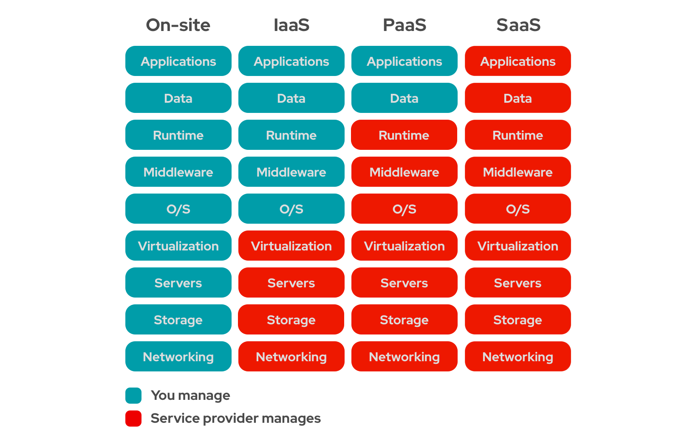

Una de las ventajas de la virtualización y de la tecnología de contenedores es que el equipo de desarrollo puede trabajar en exactamente el mismo entorno en el que se ejecutará la aplicación en producción. La ganancia de tiempo a la hora de realizar un despliegue es evidente.

Los contenedores ofrecen ventajas similares a las de las máquinas virtuales, pero optimizando el uso de recursos. Un contenedor no virtualiza el hardware ni arranca un sistema operativo completo: es un conjunto de procesos aislados que comparten el kernel del sistema anfitrión. Por eso arranca en mucho menos tiempo que una máquina virtual y consume únicamente la memoria que usan sus procesos, mientras que una máquina virtual necesita además memoria para su propio sistema operativo.

Otra ventaja clave es la escalabilidad automática. Las plataformas PaaS permiten aumentar o reducir los recursos asignados a una aplicación de forma dinámica en función de la demanda, lo que garantiza un buen rendimiento sin necesidad de intervención manual.

Como desventaja, el usuario depende en mayor medida del proveedor, lo que puede limitar ciertas configuraciones avanzadas o generar dependencia tecnológica (*vendor lock-in*).

**Azure** es la plataforma cloud de Microsoft, lo que coloquialmente llamamos "la nube". Permite el acceso bajo demanda a múltiples recursos computacionales: almacenamiento, servidores, aplicaciones y servicios. Azure ofrece servicios de los tres modelos (SaaS, IaaS y PaaS), aunque en este tutorial nos centraremos en su faceta PaaS. La gestión que tradicionalmente se hacía *on-premise* se aleja del usuario, ya que el proveedor aloja el hardware y el software en su propia infraestructura y ofrece una solución integrada.

De acuerdo con [Microsoft](https://azure.microsoft.com/es-es/resources/cloud-computing-dictionary/what-is-saas), en la siguiente imagen se pueden ver las diferencias entre los modelos `-aaS` en función de los requisitos de hardware y software necesarios.

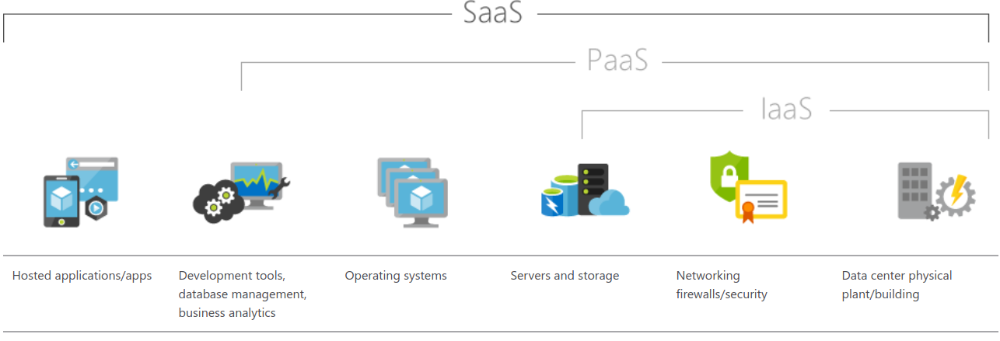

Los tres modelos proporcionan soluciones escalables que siguen el modelo de pago por uso. En la práctica, un PaaS ofrece lo mismo que un SaaS excepto la propia aplicación, que debe desarrollar y mantener el desarrollador. Básicamente, a este nivel, los desarrolladores pueden desarrollar y desplegar aplicaciones sin consumir recursos de su máquina local. Otros ejemplos de PaaS, además de Azure, son *Heroku* y *Google App Engine*.

Para comprender qué es Azure y por qué es interesante utilizarlo, vamos a plantear un ejemplo de integración con `Docker`. La idea detrás de Docker es utilizar contenedores portables que consumen pocos recursos para encapsular diferentes aplicaciones de software que, además, puedan ejecutarse en cualquier máquina que tenga `Docker` instalado, incluso en una nube como *Azure*. Un contenedor es autocontenido: lleva consigo todo lo que la aplicación necesita y se puede llevar a cualquier parte.

La portabilidad tiene un límite: la **arquitectura del procesador**. Una imagen construida solo para x86-64 (`amd64`) no se ejecuta de forma nativa en un equipo ARM (`arm64`, como un Mac con chip M1, M2 o posterior), y viceversa. Lo verás en el apartado de errores comunes.

`Docker` necesita que dentro del contenedor esté todo aquello que la aplicación va a necesitar (o, al menos, que se le indique dónde debe ir a buscarlo). Una gran ventaja es que las dificultades de instalación, las dependencias y demás quebraderos de cabeza quedan encerrados en la imagen y se resuelven una única vez. Si además se fijan las versiones de la imagen base y de las dependencias, se evitan en gran medida los problemas de incompatibilidades al actualizar una librería. Por si fuera poco, existe un registro público en la nube para las imágenes, llamado [Docker Hub](https://hub.docker.com/), en el que cada imagen se publica con etiquetas de versión.

Una `imagen Docker` es una plantilla de solo lectura para crear contenedores. Contiene el sistema de ficheros base, las librerías, las dependencias, la aplicación y metadatos como el comando que debe ejecutarse al arrancar. Un contenedor se arranca a partir de una imagen y, como hemos dicho, las imágenes se pueden publicar y descargar desde [Docker Hub](https://hub.docker.com/), que está gestionado por Docker.

El `registry` (registro) es el servicio remoto que se utiliza para almacenar y recuperar las imágenes (con todas las versiones que se hayan subido). Además de Docker Hub, existen registros privados, como Azure Container Registry, y también es posible montar un registro propio.

Un `contenedor Docker` es una instancia, en ejecución o parada, de una imagen. En la práctica se usa de forma parecida a una máquina virtual ligera, aunque técnicamente no lo es. Es posible arrancar, pausar o parar los contenedores, y las operaciones de escritura (por ejemplo, crear un fichero) no afectan a la imagen: se guardan en una capa de escritura propia del contenedor, que se pierde al eliminarlo (salvo que se usen volúmenes).

Para la gestión de los contenedores (arranque, parada, pausa, etc.) se utiliza el `Docker Engine` (el demonio `dockerd`), que permite además la gestión de las imágenes (descarga, construcción, publicación, etc.). El Docker Engine expone una API REST, que es la que utiliza el cliente.

Por último, el `cliente Docker` es la interfaz de línea de comandos (CLI, el comando `docker`) que se utiliza para controlar el `Docker Engine`.

Para poder llevar a cabo el ejemplo es necesario disponer de un entorno de desarrollo y despliegue configurado adecuadamente para `Azure` y `Docker`. A continuación verás los pasos necesarios y, además, un pequeño tutorial de introducción a ambas tecnologías.

# Configuración del entorno

A continuación se muestra un conjunto mínimo de pasos necesarios para configurar `Docker` y ser capaz de descargar imágenes ya creadas o generar las tuyas propias a partir de un Dockerfile y subirlas al registro. Se muestra sobre una máquina con Ubuntu 24.04, pero es equivalente en otros sistemas operativos sobre los que pueda ejecutarse Docker.

## Pasos previos

1. Crea una cuenta en Docker Hub: [enlace](https://hub.docker.com/signup).

2. Instala Docker en tu máquina. En Linux, instala *Docker Engine* siguiendo la [guía oficial](https://docs.docker.com/engine/install/), que instala también el plugin de Docker Compose. En Windows y macOS, instala [Docker Desktop](https://docs.docker.com/get-started/get-docker/).

3. Instala un cliente `Git` en tu máquina.

4. Despliega la primera aplicación *dockerizada* siguiendo los pasos del apartado siguiente.

## Hola Mundo en Docker

Para verificar que la instalación es correcta y que todo funciona adecuadamente, clona una aplicación de ejemplo desde GitHub:

```{bash eval=F}
apuentec:~> mkdir ics-master
apuentec:~> cd ics-master
apuentec:~/ics-master> git clone -b v1 https://github.com/docker-training/node-bulletin-board
Cloning into 'node-bulletin-board'...
apuentec:~/ics-master> cd node-bulletin-board/bulletin-board-app
apuentec:~/ics-master/node-bulletin-board/bulletin-board-app> ls
app.js  backend  Dockerfile  fonts  index.html  LICENSE  package.json  readme.md  server.js  site.css
```

Muestra el contenido del fichero *Dockerfile*:

```{bash eval=F}
apuentec:~/ics-master/node-bulletin-board/bulletin-board-app> cat Dockerfile
FROM node:6.11.5

WORKDIR /usr/src/app
COPY package.json .
RUN npm install
COPY . .

CMD [ "npm", "start" ]
```

> **Importante: actualiza la imagen base.** El repositorio original usa `node:6.11.5`, una versión de Node.js de 2017 que lleva años sin soporte ni actualizaciones de seguridad. Antes de continuar, edita la primera línea del `Dockerfile` para usar una versión LTS actual:
>
> ```
> FROM node:24-slim
> ```
>
> El resto del fichero no necesita cambios. Node.js 24 tiene soporte hasta abril de 2028. La variante `-slim` es una imagen reducida, más ligera que la imagen completa, y se publica tanto para `amd64` como para `arm64`.

El contenido del fichero `package.json` es el siguiente:

```{bash eval=F}
apuentec:~/ics-master/node-bulletin-board/bulletin-board-app> cat package.json
{
  "name": "vue-event-bulletin",
  "version": "1.0.0",
  "description": "Demo application for the scotch.io tutorial",
  "main": "server.js",
  "author": "Ryan Chenkie, Jason Lam",
  "license": "MIT",
  "dependencies": {
    "bootstrap": "^3.3.6",
    "ejs": "^2.3.4",
    "express": "^4.13.3",
    "morgan": "^1.6.1",
    "vue": "^1.0.10",
    "vue-resource": "^0.1.17"
  },
  "devDependencies": {
    "body-parser": "^1.14.1",
    "errorhandler": "^1.4.2",
    "method-override": "^2.3.5",
    "morgan": "^1.6.1"
  }
}
```

Se trata de una aplicación de demostración de Node.js con licencia MIT: un tablón de eventos que escucha en el puerto 8080. Las instrucciones del `Dockerfile` (palabras clave en mayúsculas) se explicarán más adelante.

Un *Dockerfile* es un fichero de texto donde se indican, en orden, las instrucciones necesarias para construir una imagen a partir de una imagen base. Es el fichero que lee el comando `docker build` para construir la imagen.

Más adelante verás buenas prácticas a la hora de crear un Dockerfile.

En el ejemplo anterior se parte de la imagen oficial de Node.js disponible en Docker Hub.

# Docker

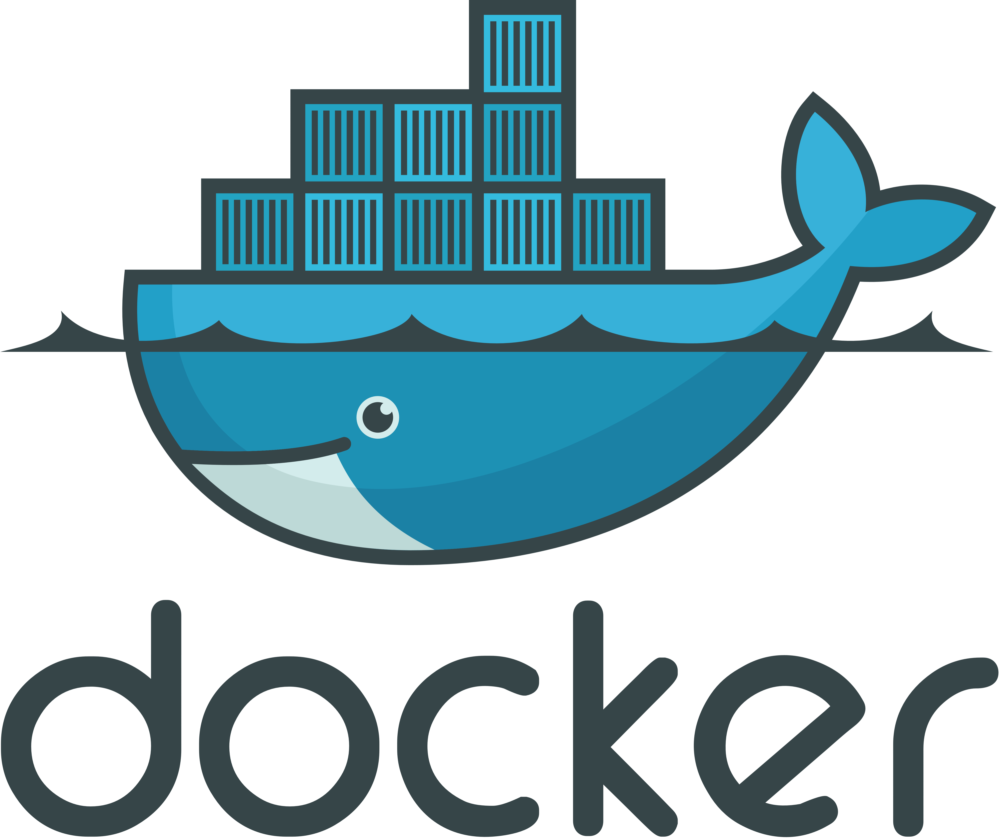

Construye y prueba tu primera imagen Docker para comprobar que la instalación es correcta.

En Linux, el demonio de Docker escucha en un *socket* de Unix (`/var/run/docker.sock`) que pertenece al usuario root, por lo que, por defecto, el resto de usuarios deben usar `sudo` con cada comando `docker`.

Para usar `docker` sin `sudo`, primero crea el grupo `docker` (en muchas instalaciones ya existe y el comando simplemente avisará de ello):

```{bash, eval=F}
$ sudo groupadd docker
```

y añade tu usuario a dicho grupo:

```{bash, eval=F}
$ sudo usermod -aG docker $USER
```

Después cierra la sesión y vuelve a entrar para que se aplique la pertenencia al grupo. También puedes aplicarla en la terminal actual con `newgrp docker`. Para comprobar que funciona, ejecuta `docker run hello-world` sin `sudo`. Tienes más información sobre los pasos posteriores a la instalación en Linux en el siguiente [enlace](https://docs.docker.com/engine/install/linux-postinstall/).

> **Aviso de seguridad:** según la documentación oficial, el grupo `docker` concede privilegios equivalentes a los de root. Hazlo solo en tu equipo de desarrollo.

## Docker service

Verifica que el demonio de Docker está en ejecución y que no hay ningún problema:

```{bash eval=F}
apuentec:~> systemctl status docker
● docker.service - Docker Application Container Engine
     Loaded: loaded (/usr/lib/systemd/system/docker.service; enabled; preset: enabled)
     Active: active (running) since Mon 2026-10-26 11:38:16 CET; 56min ago
TriggeredBy: ● docker.socket
       Docs: https://docs.docker.com
   Main PID: 29858 (dockerd)
...
```

En Windows y macOS no hay servicio `systemd`: basta con que Docker Desktop esté abierto. En cualquier sistema, `docker version` muestra las versiones del cliente y del motor.

## Docker image build

Genera la imagen del proyecto que acabas de descargar (recuerda haber cambiado antes la línea `FROM`). Para ello, ejecuta el comando `docker image build` (equivalente a `docker build`) desde el directorio que contiene el `Dockerfile`. El punto final (`.`) indica el **contexto de construcción**: el directorio cuyos ficheros podrán copiarse a la imagen.

```{bash eval=F}
apuentec:~/ics-master/node-bulletin-board/bulletin-board-app> docker image build -t bulletinboard:1.0 .
```

Desde Docker Engine 23.0, el constructor por defecto en Linux es **BuildKit**. En una terminal interactiva verás una vista compacta, encabezada por `[+] Building ...`, que se va actualizando. Para ver el detalle de cada paso, añade `--progress=plain`. La salida tiene este aspecto (recortada):

```{bash eval=F}
#1 [internal] load build definition from Dockerfile
#1 transferring dockerfile: 147B done
#1 DONE 0.0s

#2 [internal] load metadata for docker.io/library/node:24-slim
...
#5 [1/5] FROM docker.io/library/node:24-slim@sha256:...
...
#6 [2/5] WORKDIR /usr/src/app
#6 DONE 0.1s

#7 [3/5] COPY package.json .
#7 DONE 0.0s

#8 [4/5] RUN npm install
#8 9.507 added 109 packages, and audited 110 packages in 9s
#8 9.509 2 vulnerabilities (1 moderate, 1 critical)
...
#8 DONE 9.6s

#9 [5/5] COPY . .
#9 DONE 0.0s

#10 exporting to image
#10 naming to docker.io/library/bulletinboard:1.0 done
#10 DONE 1.7s
```

En tutoriales antiguos verás una salida distinta ("Step 1/6", "Running in…", "Removing intermediate container…"), que corresponde al constructor clásico.

Los avisos `npm warn deprecated` y el resumen de vulnerabilidades que aparecen durante `npm install` son normales: la aplicación de ejemplo usa dependencias antiguas. No impiden que la imagen se construya ni que la aplicación funcione.

Fíjate en que cada instrucción del Dockerfile aparece como un paso numerado (`[1/5]` … `[5/5]`). La instrucción `CMD` no aparece porque solo añade metadatos a la imagen. Docker guarda el resultado de cada paso en una caché. Si vuelves a ejecutar el mismo comando sin cambiar nada, los pasos aparecerán marcados como `CACHED` y la construcción terminará casi al instante. Si modificas un fichero de la aplicación, solo se repetirá el último `COPY . .`. En cambio, si modificas `package.json`, se repetirán su `COPY` y todos los pasos posteriores, incluido `npm install`.

Los comandos generales para la gestión de contenedores son los siguientes:

* `docker run`: crea un nuevo contenedor a partir de una imagen y lo arranca (si la imagen no está en local, primero la descarga).

* `docker start`: arranca un contenedor existente que está parado.

* `docker stop`: para un contenedor en ejecución de forma ordenada. Si el proceso no termina en unos segundos, lo fuerza.

* `docker kill`: para un contenedor de forma inmediata.

* `docker rm`: elimina un contenedor parado.

A continuación se presentan los comandos de gestión básicos.

## Docker container run

Inicia un contenedor con la nueva imagen. Para ello, ejecuta el comando `docker container run` (equivalente a `docker run`). Fíjate en que se publica el puerto 8000 de la máquina local y se enlaza con el 8080 del contenedor, que es en el que escucha la aplicación:

```{bash eval=F}
apuentec:~/ics-master/node-bulletin-board/bulletin-board-app> docker container run --publish 8000:8080 --detach --name bb bulletinboard:1.0
7865556a2438754385b738f74c08474d1d3ffaa8bbee3d39b1b3310cdd462399
```

Con `--publish` (`-p`) se publica un puerto con el formato `puerto_anfitrión:puerto_contenedor`; con `--detach` (`-d`) se indica que el contenedor se ejecute en segundo plano; con `--name`, que tenga un nombre determinado (en este caso, `bb`); y con `bulletinboard:1.0`, que se cree a partir de la imagen `bulletinboard` en su versión `1.0`. El comando devuelve el identificador completo del contenedor.

Abre un navegador web con la dirección [http://localhost:8000](http://localhost:8000) y comprueba qué aparece. Debería ser como lo que aparece en la siguiente imagen:

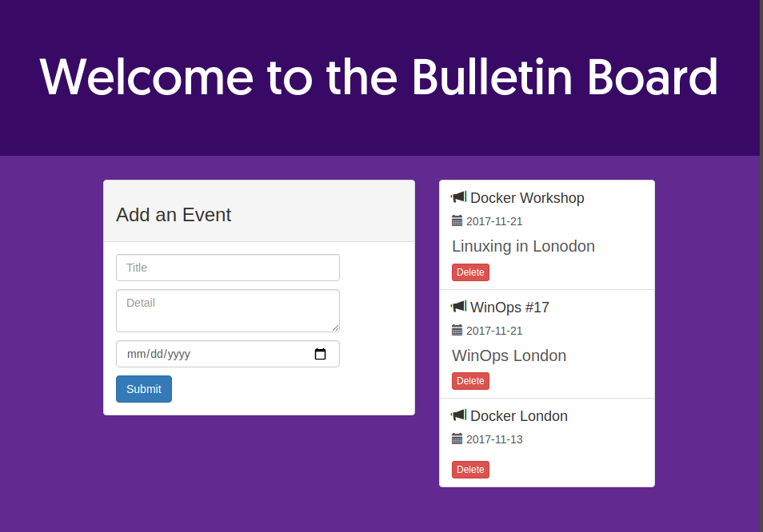

## Docker ps

Lista los contenedores Docker en ejecución y elimina el que acabas de crear. Para listar los contenedores activos se utiliza el comando `docker ps` (equivalente a `docker container ls`):

```{bash eval=F}
apuentec:~/ics-master/node-bulletin-board/bulletin-board-app> docker ps
CONTAINER ID   IMAGE               COMMAND                  CREATED         STATUS         PORTS                    NAMES
7865556a2438   bulletinboard:1.0   "docker-entrypoint.s…"   4 seconds ago   Up 3 seconds   0.0.0.0:8000->8080/tcp   bb
```

La columna `COMMAND` muestra `docker-entrypoint.s…` porque la imagen oficial de Node define un `ENTRYPOINT` (`docker-entrypoint.sh`) que recibe como argumentos el `CMD` de tu Dockerfile (`npm start`). Lo verás en el apartado de `CMD` y `ENTRYPOINT`.

Si intentas eliminar con `docker container rm` un contenedor que está en ejecución, obtendrás un error:

```{bash eval=F}
apuentec:~> docker container rm bb
Error response from daemon: cannot remove container "bb": container is running: stop the container before removing or force remove
```

Tienes que pararlo antes con `docker stop bb` o forzar su eliminación con la opción `--force` (`-f`), indicando el nombre del contenedor o los primeros caracteres de su CONTAINER ID:

```{bash eval=F}
apuentec:~> docker container rm --force bb
bb
```

## Docker images

Puedes listar las imágenes disponibles en local con el comando `docker images` (equivalente a `docker image ls`). Desde Docker 29, la salida por defecto tiene este formato:

```{bash eval=F}
apuentec:~> docker images
IMAGE               ID             DISK USAGE   CONTENT SIZE   EXTRA
bulletinboard:1.0   3b482f35c8dd        ...MB         ...MB    U
node:24-slim        ...                 ...MB         ...MB
```

* `IMAGE`: nombre y tag de la imagen.
* `ID`: identificador de la imagen (abreviado).
* `DISK USAGE`: espacio que ocupa la imagen en disco.
* `CONTENT SIZE`: tamaño del contenido de la imagen.
* `EXTRA`: indicadores adicionales; `U` (*In Use*) significa que algún contenedor está usando la imagen.

En versiones anteriores de Docker verás el formato clásico, con las columnas `REPOSITORY`, `TAG`, `IMAGE ID`, `CREATED` y `SIZE`. Puedes obtener una tabla similar con la opción `--format`:

```{bash eval=F}
apuentec:~> docker images --format "table {{.Repository}}\t{{.Tag}}\t{{.ID}}\t{{.Size}}"
REPOSITORY      TAG       IMAGE ID       SIZE
bulletinboard   1.0       3b482f35c8dd   ...MB
node            24-slim   ...            ...MB
```

## Docker rmi

También puedes eliminar imágenes del sistema con el comando `docker rmi` (equivalente a `docker image rm`), indicando su nombre y tag o su ID:

```{bash eval=F}
apuentec:~> docker rmi bulletinboard:1.0
Untagged: bulletinboard:1.0
Deleted: sha256:5c5886bd204526dc418ba1032a6ff2f4c06059625ab4e09026b0af37d46c6d62
```

Si una imagen está siendo usada por algún contenedor (aunque esté parado), Docker no permite eliminarla:

```{bash eval=F}
apuentec:~> docker rmi bulletinboard:1.0
Error response from daemon: conflict: unable to delete bulletinboard:1.0 (must be forced) - container 7865556a2438 is using its referenced image 5c5886bd2045
```

En ese caso, elimina antes el contenedor o fuerza el borrado de la imagen con `docker rmi -f`.

## Docker search

Puedes buscar imágenes en Docker Hub desde la línea de comandos, sin necesidad de acceder a la web, con `docker search`. Por ejemplo, `docker search ubuntu` devuelve las imágenes públicas que coinciden con la palabra clave, con una breve descripción, el número de estrellas que les han dado otros usuarios y si se trata de una imagen oficial (`[OK]`). Con `--limit` puedes limitar el número de resultados:

```{bash eval=F}
apuentec:~> docker search --limit 5 ubuntu
NAME              DESCRIPTION                                     STARS     OFFICIAL
ubuntu            Ubuntu is a Debian-based Linux operating sys…   ...       [OK]
...
```

Siempre que puedas, da preferencia a las imágenes oficiales.

## Docker image pull

Para descargar una imagen se usa el comando `docker image pull` (equivalente a `docker pull`) seguido del nombre de la imagen. Las imágenes de usuarios u organizaciones llevan el nombre del propietario delante, separado por `/` (por ejemplo, `ubuntu/nginx`), mientras que las imágenes oficiales no lo llevan (`ubuntu`). Detrás del nombre, separado por `:`, va el *tag* o versión.

El tag por defecto es `latest`: si no indicas ninguno, es el que se usará. Es más correcto indicar siempre la versión, porque `latest` es solo una etiqueta que el autor puede mover a otra versión en cualquier momento. Por ejemplo, `ubuntu:latest` apuntaba a Ubuntu 24.04 y hoy apunta a Ubuntu 26.04.

```{bash eval=F}
apuentec:~> docker image pull ubuntu:24.04
24.04: Pulling from library/ubuntu
...
Status: Downloaded newer image for ubuntu:24.04
docker.io/library/ubuntu:24.04
```

Las versiones actuales de Docker (v28.2 en adelante) ya no pueden descargar imágenes antiguas publicadas con el formato de manifiesto *schema 1*. Si al hacer `pull` de una imagen antigua aparece un error que menciona `schema 1`, busca una alternativa más reciente.

## Docker container run -it

Puedes arrancar un contenedor y acceder a él de forma interactiva. Es muy útil, sobre todo al principio, para comprobar que todo está bien o buscar determinados ficheros y rutas. Para ello, lanza el comando `docker container run -it` seguido del nombre de la imagen y del comando que debe ejecutar el contenedor; en este caso, `/bin/bash`, para que abra una shell. La opción `-i` mantiene abierta la entrada estándar y `-t` asigna una terminal:

```{bash eval=F}
apuentec:~> docker container run -it ubuntu:24.04 /bin/bash
root@c1576d0b4968:/# head -n 2 /etc/os-release
PRETTY_NAME="Ubuntu 24.04.x LTS"
NAME="Ubuntu"
root@c1576d0b4968:/# exit
```

Al salir de la shell (`exit`), el proceso principal termina y el contenedor se para.

## Docker logs

En ocasiones es necesario revisar los logs de un contenedor, por ejemplo cuando lanzas un contenedor y ves que se para sin motivo aparente. `docker logs`, seguido del nombre o del CONTAINER ID, muestra todo lo que el proceso principal del contenedor ha escrito en su salida estándar y de error. Por ejemplo, la salida del contenedor de bulletinboard es la siguiente:

```{bash eval=F}
apuentec:~> docker logs bb

> vue-event-bulletin@1.0.0 start
> node server.js

Magic happens on port 8080...
GET / 200 4.891 ms - 1825
```

La última línea la escribe la aplicación cada vez que recibe una petición (en este caso, la que hiciste desde el navegador). Con la opción `-f` (`docker logs -f bb`) puedes seguir los logs en tiempo real; sales con `Ctrl+C`.

## Limpieza del sistema

Después de trabajar un tiempo con Docker, no es extraño notar un uso elevado del disco. Es recomendable conservar únicamente las imágenes necesarias: las que sirven de base para las imágenes finales y las imágenes finales con las que estás trabajando.

Una forma habitual de trabajar es generar una imagen base con todas las dependencias pesadas y construir una segunda imagen que parte de ella y añade la aplicación. Esto es así porque se espera que la imagen base cambie poco a lo largo del desarrollo, mientras que la aplicación cambia con frecuencia. Así se evita repetir instalaciones largas en cada construcción.

Puedes listar los contenedores en ejecución (`docker container ls`) y también los parados (`docker container ls -a`):

```{bash eval=F}
apuentec:~> docker container ls -a
CONTAINER ID   IMAGE          COMMAND       CREATED          STATUS                      PORTS     NAMES
c1576d0b4968   ubuntu:24.04   "/bin/bash"   9 minutes ago    Exited (0) 8 minutes ago              hungry_ptolemy
83a2fea9e1b0   ubuntu:24.04   "/bin/bash"   12 minutes ago   Exited (0) 9 minutes ago              nervous_lederberg
```

Si no indicas `--name` al crear un contenedor, Docker le asigna un nombre aleatorio (como `hungry_ptolemy`). Para eliminar contenedores, indica al comando `docker container rm` sus nombres o sus CONTAINER ID (completos o sus primeros caracteres):

```{bash eval=F}
apuentec:~> docker container rm c1576d0b4968 83a2fea9e1b0
c1576d0b4968
83a2fea9e1b0
```

Docker incluye además comandos `prune` para hacer limpieza rápidamente (más información en el siguiente [enlace](https://docs.docker.com/engine/manage-resources/pruning/)). Todos piden confirmación, salvo que añadas `-f`:

```{bash eval=F}
# Elimina todos los contenedores parados
apuentec:~> docker container prune

# Elimina las imágenes sin tag que no usa ningún contenedor
apuentec:~> docker image prune

# Elimina contenedores parados, redes sin usar, imágenes sin tag y caché de construcción sin usar
apuentec:~> docker system prune
```

Si necesitas parar rápidamente todos los contenedores en ejecución, puedes usar `docker stop $(docker ps -q)`.

Para eliminar una imagen se utiliza, como has visto, `docker rmi` seguido de su nombre y tag o de su ID.

## Dockerfile

Algunas de las [buenas prácticas](https://docs.docker.com/build/building/best-practices/) que se recomiendan a la hora de crear un Dockerfile son las siguientes:

* Mantén la imagen lo más pequeña posible; de lo contrario, la construcción, el despliegue y la descarga de la imagen llevarán más tiempo del necesario.
* No instales paquetes o dependencias innecesarios. Dedica un tiempo a estudiar los requisitos técnicos de la imagen que vas a generar.
* Ten en cuenta las capas y la caché: busca un equilibrio entre el número de instrucciones y la legibilidad, y ordena las instrucciones de la que menos cambia a la que más cambia. Por eso, en el ejemplo, se copia `package.json` y se ejecuta `npm install` **antes** de copiar el resto del código.
* Usa la barra invertida `\` para repartir una instrucción larga en varias líneas y que el fichero sea lo más legible posible. Por ejemplo, para la instalación de librerías de uso general:

```{bash eval=F}
# Sección de instalación de librerías de uso general
RUN apt-get update && apt-get install -y --no-install-recommends \
	libcurl4-gnutls-dev \
	libcairo2-dev \
	libxt-dev \
	libssl-dev \
	libssh2-1-dev \
&& rm -rf /var/lib/apt/lists/*
```

A continuación se comentan algunas de las instrucciones más habituales de un Dockerfile. Para obtener información más detallada, consulta la [referencia oficial](https://docs.docker.com/reference/dockerfile/). Existen otras instrucciones además de las que se muestran aquí.

### FROM

Indica la imagen de partida a partir de la cual se comenzará a crear la imagen. Si la imagen no está en local, Docker la descargará del registro (por ejemplo, Docker Hub). Toda imagen tiene un `nombre` y un `tag`. Esta es una de las cosas que hacen que Docker sea tan útil: siempre será posible partir de la imagen concreta, en su versión precisa, para replicar un comportamiento.

Sintaxis:

```{bash eval=F}
FROM <nombre.imagen>
FROM <nombre.imagen>:<tag>
```

### WORKDIR

La instrucción `WORKDIR` fija el directorio de trabajo de cualquier instrucción `RUN`, `CMD`, `ENTRYPOINT`, `COPY` o `ADD` que aparezca a continuación en el `Dockerfile`, y también el directorio en el que arrancará el contenedor. Se puede utilizar varias veces; si indicas una ruta relativa, lo será respecto al `WORKDIR` anterior. Por ejemplo, tras `WORKDIR /a`, `WORKDIR b` y `WORKDIR c`, el directorio de trabajo es `/a/b/c`. Si el directorio no existe, se crea. Además, se puede usar junto con variables de entorno definidas con `ENV`.

La sintaxis es la siguiente:

```{bash eval=F}
ENV DIRPATH=/path
WORKDIR $DIRPATH/nombreDirectorio
```

### RUN

Ejecuta un comando durante la construcción de la imagen y guarda el resultado como una nueva capa. Gracias a la caché, si detectas un fallo o falta una librería y vuelves a construir la imagen, Docker reutiliza los pasos que no han cambiado y ejecuta únicamente la instrucción modificada y las posteriores. Esto supone un ahorro de tiempo considerable. La instrucción `RUN` puede escribirse de dos formas: forma *shell* y forma *exec*.

**Forma shell**

El comando se ejecuta a través de una shell (`/bin/sh -c` en Linux), por lo que puedes usar variables, tuberías (`|`), `&&`, etc.:

```{bash eval=F}
RUN comando parámetro
```

**Forma exec**

El comando se ejecuta directamente, sin shell. Se escribe como una lista JSON, con comillas dobles:

```{bash eval=F}
RUN ["comando", "parámetro", "parámetro"]
```

### ENV

La instrucción `ENV` define variables de entorno que estarán disponibles para las instrucciones siguientes del fichero y también dentro del contenedor en ejecución.

La sintaxis es la siguiente:

```{bash eval=F}
ENV <clave>=<valor>
```

La forma antigua `ENV <clave> <valor>` (separada por un espacio) sigue funcionando, pero Docker muestra el aviso `LegacyKeyValueFormat` al construir.

### ADD y COPY

Copian ficheros o directorios desde el contexto de construcción a la imagen, en la ruta especificada. La recomendación de Docker es usar `COPY`, que simplemente copia ficheros, salvo que necesites alguna de las capacidades adicionales de `ADD`:

* `ADD` descomprime automáticamente en el destino los archivos comprimidos (`.tar`, `.tar.gz`, etc.) **locales**.
* `ADD` puede descargar ficheros desde una URL (sin descomprimirlos).

La sintaxis es la siguiente:

```{bash eval=F}
COPY <origen> <destino>
```

Solo se pueden copiar ficheros que estén dentro del contexto de construcción.

### EXPOSE

La instrucción `EXPOSE` documenta los puertos en los que el contenedor escuchará conexiones entrantes. Lo más habitual es utilizar el mismo puerto que usaría la aplicación desplegada de forma convencional (por ejemplo, el 80 para un servidor web), aunque no es obligatorio.

`EXPOSE` **no publica** el puerto. Para que sea accesible desde fuera del contenedor tienes que usar la opción `-p` (`--publish`) de `docker run` o la sección `ports` de Docker Compose. Con `docker run -P` (en mayúscula), Docker publica todos los puertos declarados con `EXPOSE` en puertos aleatorios del anfitrión.

La sintaxis es la siguiente:

```{bash eval=F}
EXPOSE 8080
```

### CMD y ENTRYPOINT

Ambas instrucciones determinan qué se ejecuta cuando arranca un contenedor. Si una imagen no define ninguna de las dos (ni la hereda de su imagen base), tendrás que indicar el comando explícitamente en `docker run`.

`CMD` define el comando **por defecto** del contenedor. Si hay varias instrucciones `CMD`, solo se tiene en cuenta la última. Puedes sustituirlo indicando otro comando al final de `docker run`, como hiciste con `docker run -it ubuntu:24.04 /bin/bash`. Por ejemplo, la imagen oficial de Ubuntu termina con `CMD ["/bin/bash"]`.

`ENTRYPOINT` define el ejecutable **principal** del contenedor. Lo que escribas al final de `docker run` no lo sustituye, sino que se le pasa como argumentos. Para cambiarlo tienes que usar explícitamente la opción `--entrypoint` de `docker run`.

Cuando se usan las dos instrucciones juntas, `ENTRYPOINT` fija el ejecutable y `CMD` proporciona sus argumentos por defecto. Es lo que ocurre en la aplicación de ejemplo: la imagen oficial de Node define `ENTRYPOINT ["docker-entrypoint.sh"]` y el Dockerfile añade `CMD ["npm", "start"]`, de modo que el contenedor ejecuta `docker-entrypoint.sh npm start`.

Para ambas instrucciones se recomienda la forma *exec* (lista JSON). Con la forma *shell*, Docker muestra el aviso `JSONArgsRecommended`, porque el proceso puede no recibir correctamente las señales del sistema (por ejemplo, la de `docker stop`). Además, si `ENTRYPOINT` está en forma *shell*, se ignoran tanto `CMD` como los argumentos de `docker run`. Para una lectura más completa, consulta la [documentación oficial](https://docs.docker.com/reference/dockerfile/#understand-how-cmd-and-entrypoint-interact).

La sintaxis base para ambas instrucciones es:

```{bash eval=F}
CMD ["ejecutable", "parámetro"]
ENTRYPOINT ["ejecutable", "parámetro"]
```

### VOLUME

La instrucción `VOLUME` declara un directorio de la imagen cuyo contenido debe guardarse fuera del contenedor (por ejemplo, el directorio de datos de una base de datos). Al crear el contenedor, si no se indica otra cosa, Docker crea un volumen anónimo y lo monta en esa ruta. Para más información sobre cómo crear y compartir volúmenes desde la consola, consulta el siguiente [enlace](https://docs.docker.com/engine/storage/volumes/).

La sintaxis es la siguiente:

```{bash eval=F}
VOLUME ["/path/files", "/path/files"]
```

# Azure

Como se ha mencionado anteriormente, Azure es la plataforma cloud de Microsoft. A partir del ejemplo de bulletinboard visto al comienzo del curso, verás los pasos necesarios para desplegar un contenedor en Azure usando dos servicios: **Azure Container Registry** (ACR), el registro privado donde subirás la imagen, y **Azure Container Instances** (ACI), el servicio que ejecuta contenedores en la nube sin tener que gestionar máquinas virtuales.

## Alta en la cuenta de Azure

Lo primero que tienes que hacer es darte de alta en Azure. Para ello, visita el siguiente [enlace](https://azure.microsoft.com/es-es/free/students/).

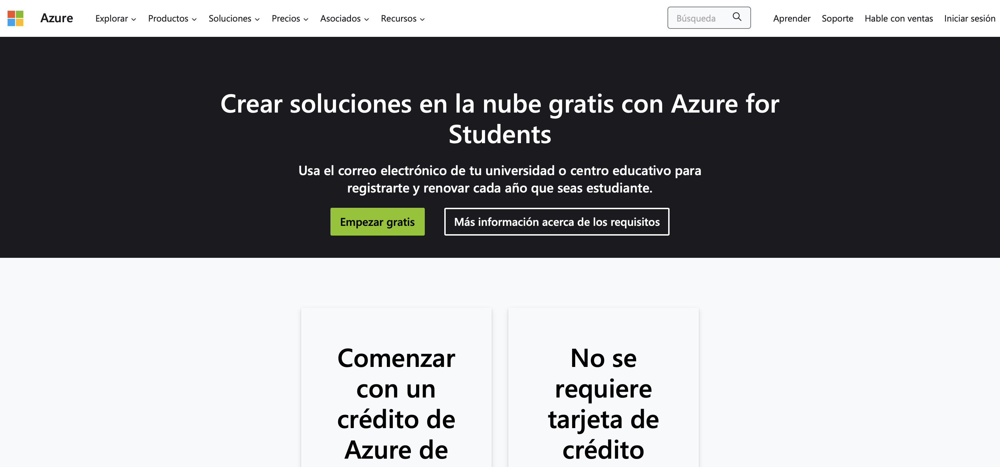

Como puedes ver, dispondrás de una cantidad de crédito y de tiempo de servicios populares gratuitos.

**NOTA MUY IMPORTANTE:** puede ser necesario crear una nueva cuenta y no usar la cuenta de la Universidad, o puede ser necesario usarla (depende del momento en que te registres y puede cambiar entre días consecutivos). Si usas la cuenta de la UDC, puede dar error por el servidor de dominio al no poder asegurar, con los permisos base de la cuenta corporativa, el acceso a Azure. _Recomendación_: crea una nueva cuenta de correo del dominio @outlook.com con un nombre del tipo `ics2026.nombre.apellidos`.

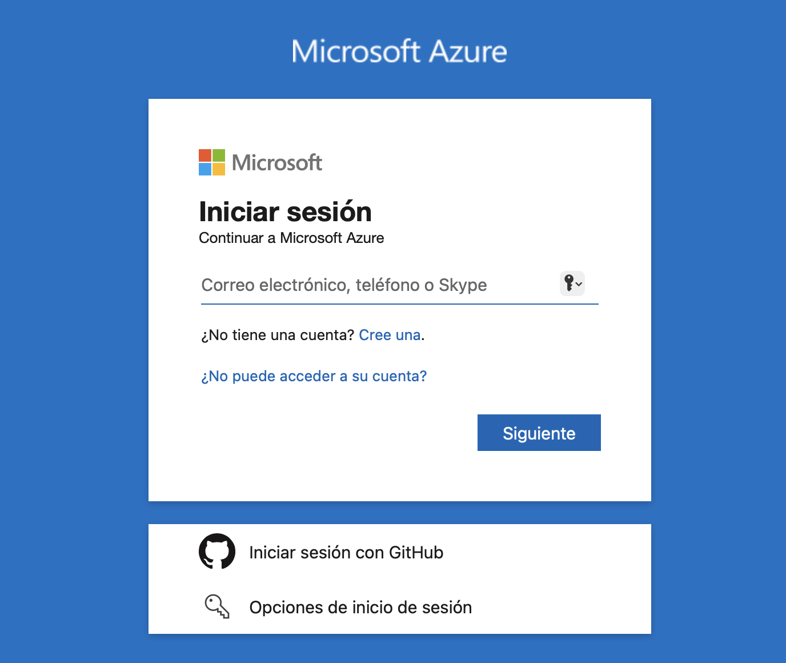

Pasarás por el alta de nuevo usuario donde, de nuevo, se te indicarán los servicios y el saldo de la cuenta gratuita.

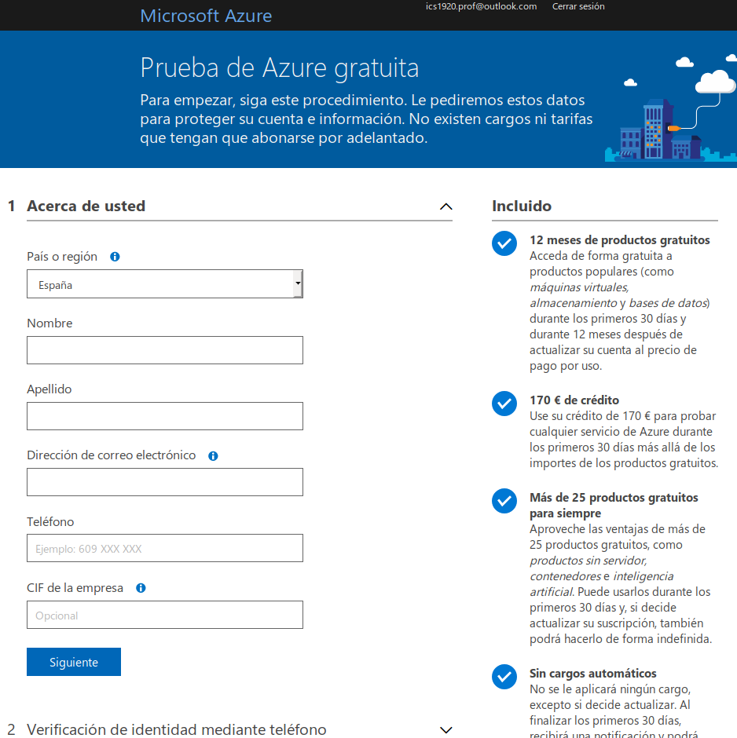

Si todo ha ido correctamente, pasarás a la vista del panel con todas las posibilidades que ofrece Azure. Todos los pasos que verás a continuación se pueden realizar tanto vía web como en consola. En este caso, se muestran únicamente los pasos a través de la consola.

## Instalación de la consola de Azure en Ubuntu

Lo primero que necesitas es instalar la interfaz de línea de comandos (CLI) de Azure. Microsoft tiene disponible un script completo de instalación para Ubuntu y Debian que se ejecuta como superusuario:

```{bash eval=F}
curl -sL https://aka.ms/InstallAzureCLIDeb | sudo bash
```

Si tienes problemas o, por algún motivo, no quieres ejecutar dicho script, puedes consultar los pasos de instalación manual en el siguiente [enlace](https://learn.microsoft.com/es-es/cli/azure/install-azure-cli-linux?pivots=apt). Comprueba la versión instalada con `az version`.

### Dependencia para despliegue de contenedores

[Helm](https://helm.sh/) es un gestor de paquetes (*charts*) para Kubernetes. **No es necesario para el despliegue de este tutorial**, que usa Azure Container Instances y no Kubernetes. Si lo necesitas para otro trabajo, puedes instalarlo con el script oficial. Actualmente hay dos: `get-helm-3` para Helm 3 y `get-helm-4` para Helm 4:

```{bash eval=F}
curl https://raw.githubusercontent.com/helm/helm/main/scripts/get-helm-4 | bash
```

El resultado es similar al de la siguiente imagen.

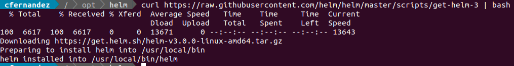

## Login a Azure desde consola

Para verificar que todo está correcto, inicia sesión en Azure desde la consola:

```{bash eval=F}
az login
```

En Linux y macOS, el comando abre el navegador para que te autentiques; en Windows usa el gestor de cuentas del sistema. Si no hay navegador disponible, recurre al inicio de sesión con un código de dispositivo. El resultado es el mostrado en la siguiente imagen.

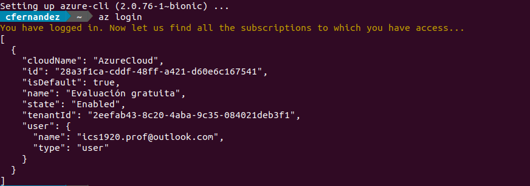

A partir de este momento, el objetivo es que tu imagen Docker esté disponible en la plataforma Azure para poder publicar tu servicio. Como en cualquier otra infraestructura `Docker`, podrías publicarla en Docker Hub y descargarla desde allí.

En todo caso, vamos a simular que se trata de aplicaciones empresariales y que no se guardan en repositorios públicos, sino en privados (solo el personal autorizado con roles predefinidos tiene acceso).

## Creación del Container Registry

Recuerda que todos los pasos se realizan por consola, pero tienen su equivalente vía web ([más información](https://learn.microsoft.com/es-es/azure/container-registry/container-registry-get-started-portal)). Lo primero que debes hacer es crear un nuevo recurso *Container Registry* o ACR. El ACR es el registro de imágenes Docker (y OCI, *Open Container Initiative*) de Azure y permite almacenar imágenes Docker de forma privada.

Para ello es necesario definir la siguiente información:

* *Registry name*: nombre del registro. Formará parte de la dirección del registro. Debe ser **único en todo Azure** y tener entre 5 y 50 caracteres, **solo letras minúsculas y números** (sin guiones). Es posible que a la primera te dé error por estar reservado por otro usuario de Azure.
* *Resource group*: agrupación lógica de recursos.
* *SKU*: nivel de servicio del registro. En principio, con la opción *Basic* será suficiente. Existen tres niveles: *Basic*, *Standard* y *Premium* ([enlace](https://learn.microsoft.com/es-es/azure/container-registry/container-registry-skus)). Los tres ofrecen las mismas funcionalidades básicas; la diferencia está en el almacenamiento incluido, el rendimiento y algunas funciones avanzadas.

Antes de crear nada, elige la **región** (*location*) en la que vas a trabajar. Idealmente, y para evitar latencia, es recomendable elegir una región cercana, pero ten en cuenta dos restricciones:

* Las suscripciones de estudiante tienen asignada una política de Azure que solo permite crear recursos en unas pocas regiones, y la lista puede variar de una cuenta a otra. Puedes consultar las tuyas en el portal: **Policy** → **Assignments** → abre la asignación cuyo nombre incluye *Allowed locations* o *Allowed resource deployment regions* y revisa la lista de regiones permitidas.
* Según Microsoft, la región **West Europe** (`westeurope`) no acepta clientes nuevos en este momento, así que es probable que no puedas usarla.

Puedes ver los nombres de todas las regiones con el siguiente comando (en los comandos se usa el nombre de la columna `Name`, por ejemplo `northeurope`, no el nombre visible `North Europe`):

```{bash eval=F}
az account list-locations -o table
```

Ten en cuenta que este comando lista todas las regiones de Azure, no solo las que tu suscripción tiene permitidas.

Ahora crea el grupo de recursos en una de tus regiones permitidas. En los ejemplos se usa `northeurope`; **sustitúyela por la tuya**:

```{bash eval=F}
az group create --name miGrupoRecursos --location northeurope
```

El resultado es el mostrado en la siguiente imagen:

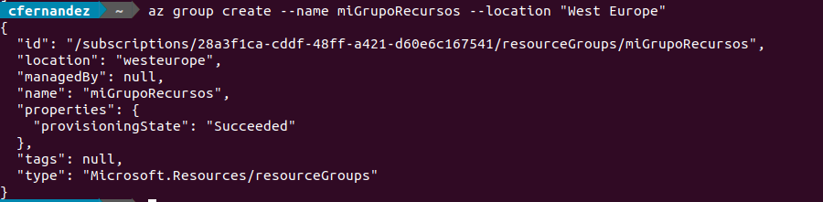

Si no indicas `--location` al crear el registro y el contenedor, ambos se crean en la región del grupo de recursos. Por eso es importante acertar con la región del grupo desde el principio.

Ahora crea el *Container Registry* en tu grupo de recursos. En los ejemplos se usa el nombre `miregistroics`; **sustitúyelo por el tuyo** en todos los comandos:

```{bash eval=F}
az acr create --name miregistroics --resource-group miGrupoRecursos --sku Basic
```

El resultado es el mostrado en la siguiente imagen:

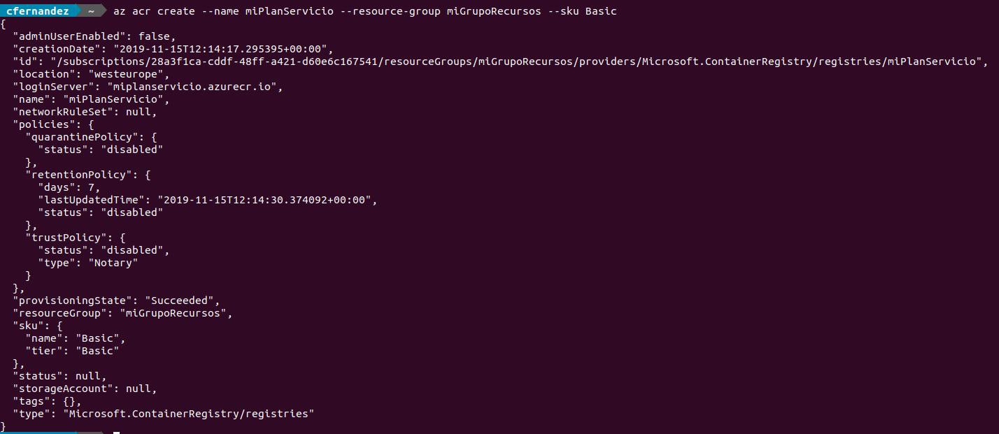

## Push de la imagen al Container registry de Azure

Ahora ya tienes lista la infraestructura de Azure para recibir tus imágenes Docker generadas en local. Para iniciar sesión en el registro, ejecuta el siguiente comando, indicando **solo el nombre del registro**:

```{bash eval=F}
az acr login --name miregistroics
```

Este comando entrega las credenciales al cliente Docker local, por lo que **Docker debe estar instalado y en ejecución**. Si todo va bien, termina con el mensaje `Login Succeeded`. La sesión caduca a las 3 horas; si más tarde te aparece un error de autenticación, vuelve a ejecutarlo. El resultado es el mostrado en la siguiente imagen:

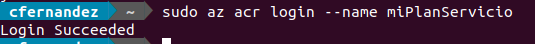

Para hacer el push de la imagen Docker es necesario generar un tag con el formato `<login server>/<nombre>:<versión>`. El *login server* es la dirección del registro. Al crearlo con la CLI como en el paso anterior, es `<nombre del registro>.azurecr.io`. Si el registro se crea desde el portal con alguna opción de protección del nombre (*Domain Name Label*), la dirección lleva además un sufijo, por ejemplo `miregistroics-abc123.azurecr.io`. Consulta siempre la dirección real de tu registro con:

```{bash eval=F}
$ az acr show --name miregistroics --query loginServer -o tsv
miregistroics.azurecr.io
```

Para generar el tag sobre una imagen local, ejecuta el siguiente comando:

```{bash eval=F}
$ docker tag bulletinboard:1.0 miregistroics.azurecr.io/bulletinboard:v1
```

Docker exige que la parte del repositorio (lo que va después de la primera `/`) esté en minúsculas. Por ejemplo, `miregistroics.azurecr.io/BulletinBoard:v1` da el error `invalid reference format: repository name (BulletinBoard) must be lowercase`. Escribe también en minúsculas el nombre del registro, como indica Microsoft.

Lista las imágenes Docker del sistema:

```{bash eval=F}
$ docker images
IMAGE                                       ID             DISK USAGE   CONTENT SIZE   EXTRA
bulletinboard:1.0                           3b482f35c8dd        ...MB         ...MB
miregistroics.azurecr.io/bulletinboard:v1   3b482f35c8dd        ...MB         ...MB
```

Fíjate en que ambas tienen el mismo ID: es la misma imagen con dos nombres. El resultado es el mostrado en la siguiente imagen:

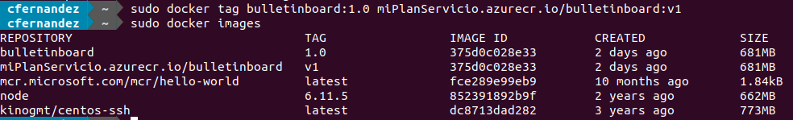

Si te hace falta, puedes generar la imagen Docker en local con el tag directamente:

```{bash eval=F}
$ docker build -t miregistroics.azurecr.io/bulletinboard:v1 .
```

Si tu equipo tiene un procesador ARM (por ejemplo, un Mac con chip M1, M2 o posterior), la imagen que construyas será `arm64`. Para que funcione en Azure Container Instances, constrúyela para `amd64`:

```{bash eval=F}
$ docker build --platform linux/amd64 -t miregistroics.azurecr.io/bulletinboard:v1 .
```

Como se trata de un repositorio privado, el servicio que ejecutará el contenedor necesita credenciales para descargar la imagen. Se puede hacer de varias formas. El despliegue de este tutorial es muy básico y no se detiene en consideraciones de seguridad ni en la creación de roles especiales; eso queda para ti. La opción más sencilla es habilitar el usuario administrador del registro. Según Microsoft, este usuario está pensado para que una sola persona acceda al registro, principalmente para pruebas; para producción recomienda usar un *service principal*. Para habilitarlo, ejecuta el siguiente comando:

```{bash eval=F}
$ az acr update -n miregistroics --admin-enabled true
```

El resultado es el mostrado en la siguiente imagen:

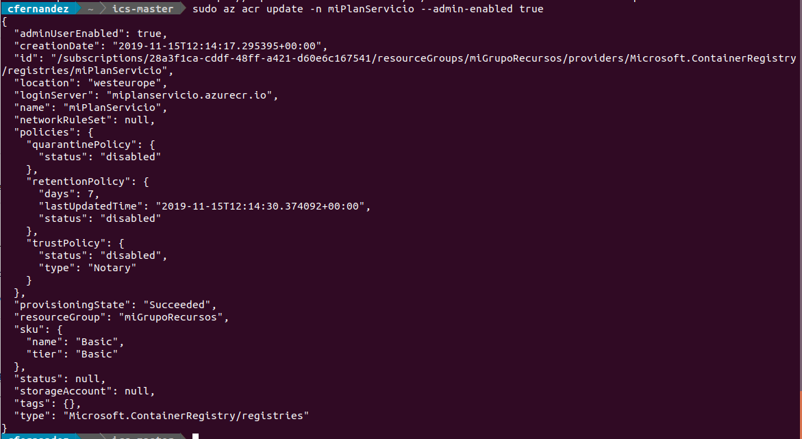

Si accedes al portal de Azure y a *Container registries*, verás allí el registro que has creado. Accediendo a él verás sus propiedades. En *Access keys* verás lo siguiente:

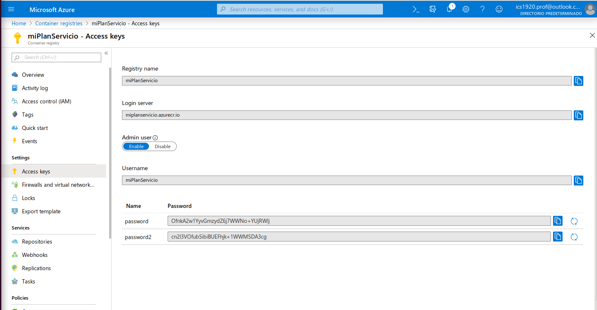

Puedes ver que está habilitado el acceso para el usuario administrador (lo has solicitado por consola en el comando anterior). También verás el nombre de usuario, que coincide con el nombre del registro, y sus contraseñas. Desde la consola puedes obtenerlas con:

```{bash eval=F}
$ az acr credential show --name miregistroics
```

Con estas credenciales también puedes iniciar sesión directamente con Docker:

```{bash eval=F}
$ docker login miregistroics.azurecr.io
```

El resultado es el mostrado en la siguiente imagen:

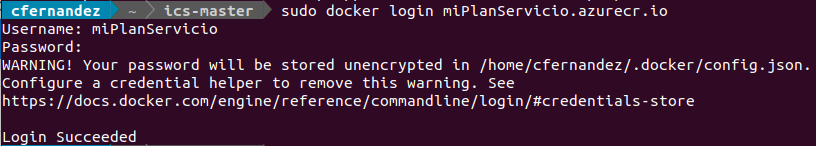

Insisto en que no se están siguiendo buenas prácticas de seguridad; el propio comando lanza un aviso al respecto. No compartas estas contraseñas ni las subas a repositorios de código.

Ahora ya puedes hacer el push de tu imagen Docker local para su despliegue en Azure con el siguiente comando:

```{bash eval=F}
$ docker push miregistroics.azurecr.io/bulletinboard:v1
```

El resultado es el mostrado en la siguiente imagen:

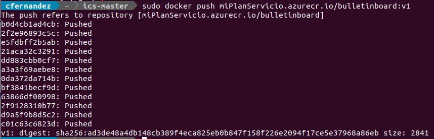

Puedes comprobar que la imagen está en el registro con:

```{bash eval=F}
$ az acr repository list --name miregistroics -o table
```

## Creación del contenedor con la imagen recién subida a Azure

Ahora que la imagen local ya está subida al registro remoto, es necesario crear el contenedor en Azure Container Instances a partir de ella. Estas son las opciones que necesitas:

* `--os-type`, `--cpu` y `--memory`: sistema operativo y recursos del contenedor. Desde la versión 2.67 de la CLI, `az container create` ya no aplica valores por defecto para estos parámetros, así que indícalos siempre.
* `--ports`: puerto que se abre. **Azure Container Instances no hace mapeo de puertos** como `docker run -p`: el puerto abierto debe ser exactamente aquel en el que escucha la aplicación (8080 en este caso). Si no lo indicas, se abre el 80.
* `--dns-name-label`: prefijo del nombre DNS público. Debe tener entre 5 y 63 caracteres (letras, números y guiones) y ser único en la región, así que añádele algo personal.
* `--registry-login-server`, `--registry-username` y `--registry-password`: credenciales del registro. Si no las indicas, la CLI te las pedirá de forma interactiva.

El nombre del contenedor (`--name`) debe estar en minúsculas, con letras, números y guiones, y tener como máximo 63 caracteres.

```{bash eval=F}
$ ACR_PASSWORD=$(az acr credential show --name miregistroics --query "passwords[0].value" -o tsv)

$ az container create \
    --resource-group miGrupoRecursos \
    --name test-bulletinboard \
    --image miregistroics.azurecr.io/bulletinboard:v1 \
    --os-type Linux \
    --cpu 1 --memory 1.5 \
    --ports 8080 \
    --dns-name-label test-bulletinboard-apc \
    --registry-login-server miregistroics.azurecr.io \
    --registry-username miregistroics \
    --registry-password "$ACR_PASSWORD"
```

El resultado es el mostrado en la siguiente imagen:

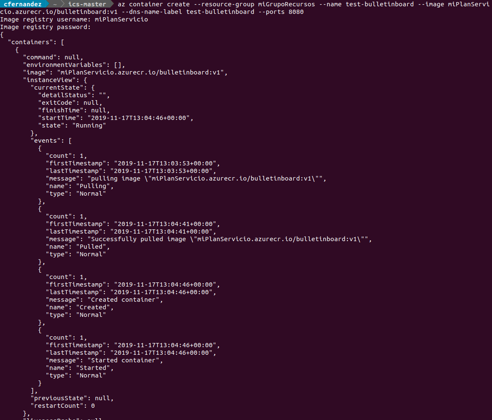

## Visita la web con la imagen operativa

Si has ejecutado todo lo anterior correctamente, podrás visitar la imagen desplegada (en este caso, la web de bulletinboard que has visto a lo largo del ejercicio).

La URL tiene el formato `http://<dns-name-label>.<zona geográfica>.azurecontainer.io:<puerto>`. Puedes consultarla, junto con el estado del despliegue, con el siguiente comando:

```{bash eval=F}
$ az container show --resource-group miGrupoRecursos --name test-bulletinboard \
    --query "{FQDN:ipAddress.fqdn,ProvisioningState:provisioningState}" --out table
```

En este ejemplo, la aplicación estaría en `http://test-bulletinboard-apc.northeurope.azurecontainer.io:8080`. Fíjate en que es `http` (no `https`) y en que tienes que indicar el puerto. Si la página no carga inmediatamente, espera unos segundos y recárgala.

El resultado es el mostrado en la siguiente imagen:

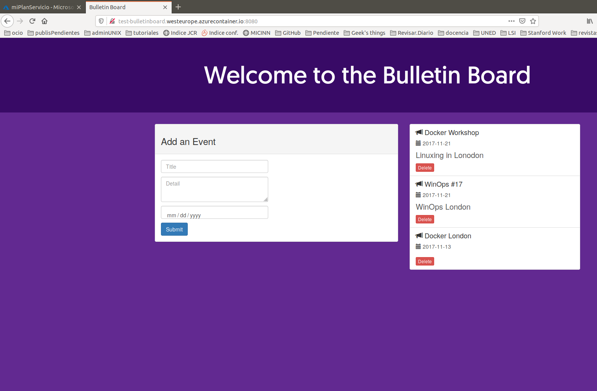

Si algo no ha salido bien, puedes revisar los logs con el siguiente comando:

```{bash eval=F}
$ az container logs --resource-group miGrupoRecursos --name test-bulletinboard
```

El resultado es el mostrado en la siguiente imagen:

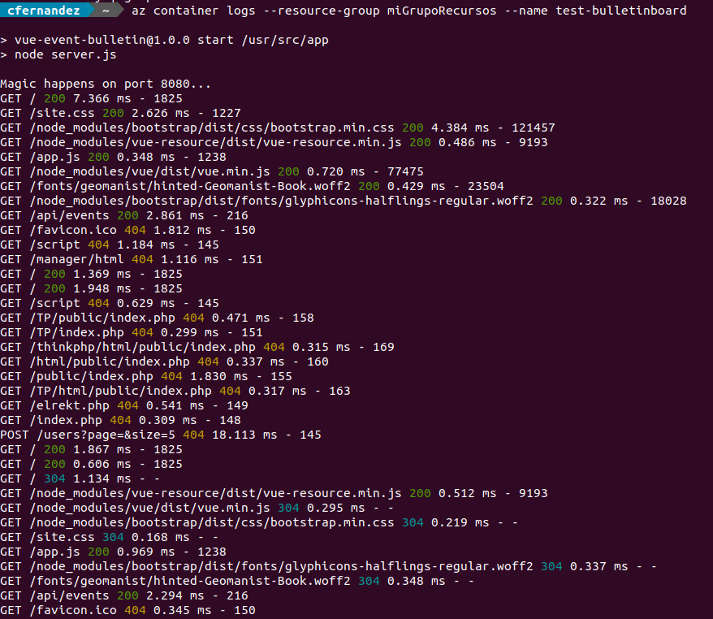

Como puedes ver en la siguiente imagen, estos pasos consumen una pequeña parte del crédito gratuito.

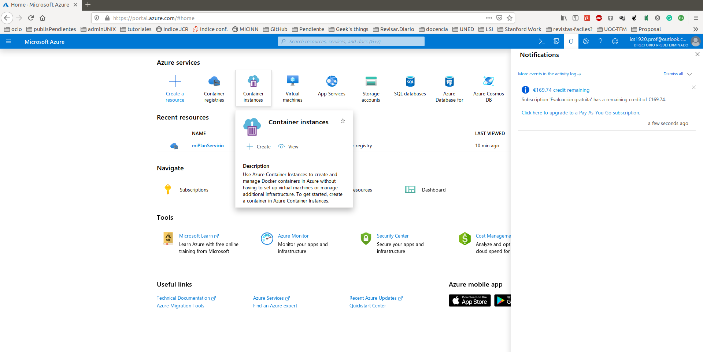

# Docker compose


La potencia y versatilidad de `Docker` a la hora de generar imágenes y contenedores es clara. La potencia real aparece cuando se plantea un despliegue más ambicioso: aplicaciones formadas por varios contenedores. Ya has visto que la práctica habitual es partir de una imagen base sobre la que se prepara la funcionalidad concreta deseada. En muchos despliegues conviene, además, tener contenedores independientes (por ejemplo, una aplicación web y su base de datos) que se lancen de manera conjunta y se comuniquen entre sí a través de una [red](https://docs.docker.com/engine/network/). La herramienta que permite definir y ejecutar aplicaciones con múltiples contenedores es [Docker Compose](https://docs.docker.com/compose/). Su funcionamiento básico consta de tres pasos:

* Escribir el `Dockerfile` de cada imagen propia.
* Definir los servicios en el fichero `compose.yaml` (también se acepta el nombre antiguo `docker-compose.yml`). De esta forma pueden ejecutarse juntos en un entorno aislado.
* Ejecutar el comando `docker compose up`.

  * **Nota:** la primera versión de Docker Compose (v1) era una herramienta independiente, escrita en Python, que se invocaba como `docker-compose` (con guion). Las versiones actuales (v2 y v5, funcionalmente idénticas) están integradas en el CLI de Docker y se invocan como `docker compose` (sin guion). Puedes comprobar tu versión con `docker compose version`.

| Característica | `docker-compose` (v1) | `docker compose` (v2 / v5) |
|---|---|---|
| Tipo | Herramienta independiente (Python) | Plugin integrado en el CLI de Docker (Go) |
| Instalación | Requería instalación separada | Incluido en Docker Desktop; en Linux, paquete `docker-compose-plugin` |
| Sintaxis | `docker-compose up` | `docker compose up` |
| Uso recomendado | Solo en sistemas antiguos | Uso estándar actual |

`Docker Compose` no sustituye al Dockerfile. Las imágenes propias se siguen construyendo con su propio Dockerfile. Lo que `Docker Compose` sí hace por ti es gestionar la configuración y el despliegue de múltiples contenedores desde un único fichero. Las diferentes secciones que se definen en el fichero son principalmente las siguientes:

**version**: en los ficheros de Compose v1 se indicaba al principio la versión del formato (por ejemplo, `version: '3'`). Las versiones actuales siguen la [especificación de Compose](https://docs.docker.com/reference/compose-file/), en la que este campo está **obsoleto**: se ignora y muestra el aviso ``the attribute `version` is obsolete``. No lo incluyas en ficheros nuevos.

**services**: lista de servicios. A cada uno de los servicios se le asigna un nombre, que además sirve como nombre de host para que los demás servicios puedan conectarse a él.

La documentación de `Docker Compose` es muy completa y puedes obtener una descripción más completa [aquí](https://docs.docker.com/reference/compose-file/services/). De todas formas, se da una perspectiva general de las opciones más comunes.

**image**: imagen (y versión) a partir de la que se crea el servicio. Si la imagen no existe en local y no se ha indicado `build`, `Docker Compose` la descarga del registro.

**build**: indica cómo construir la imagen del servicio. En su forma simple es una cadena con la ruta al contexto de construcción (el directorio que contiene el Dockerfile). En su forma extendida se pueden especificar `context`, `dockerfile` y `args`. Si se indican tanto `build` como `image`, `Docker Compose` construye la imagen y le asigna el nombre indicado en `image`.

  * **Equipos con chip ARM (M1, M2 o posteriores):** las imágenes que solo existen para `amd64` necesitan emulación, que es más lenta. Puedes indicar la plataforma de un servicio con la opción `platform: linux/amd64`.

**args**: argumentos de construcción, que se recogen en el Dockerfile con la instrucción `ARG`. Solo existen durante la construcción de la imagen; no son variables de entorno del contenedor en ejecución.

**depends_on**: fija una dependencia entre servicios, de modo que un servicio se arranca después de aquellos de los que depende. Por defecto, Compose solo espera a que el otro contenedor esté **en ejecución**, no a que esté **listo** para aceptar conexiones. Para esperar a que esté listo se usa la condición `condition: service_healthy`, junto con un `healthcheck` en el servicio del que se depende.

**ports**: puertos que se publican hacia el exterior, con el formato `"puerto_anfitrión:puerto_contenedor"`. Por ejemplo, `"8000:80"` hace accesible en el puerto 8000 de la máquina anfitriona el puerto 80 del contenedor.

**expose**: declara puertos del contenedor sin publicarlos al exterior. Los servicios de un mismo Compose comparten red y pueden comunicarse entre sí aunque no se use `expose`, por lo que es principalmente informativo.

**restart**: política de reinicio. Por defecto (`no`), el contenedor no se reinicia bajo ninguna circunstancia. Los valores posibles son `no`, `always`, `on-failure` y `unless-stopped`.

**environment**: permite definir variables de entorno del contenedor.

**volumes**: hay dos formas habituales de montar almacenamiento en un servicio. La primera es montar un directorio del anfitrión, con la sintaxis `/path/host:/path/contenedor`. La segunda es usar un volumen con nombre, gestionado por Docker, que se declara en la sección `volumes` de primer nivel y cuyo alcance por defecto es el propio proyecto de Compose. Por ejemplo:

```{bash eval=F}
volumes:
  db_web:

services:
  mi_servicio:
    ...
    volumes:
      - db_web:/path/contenedor
```

Es posible usar volúmenes con nombre externos al proyecto, pero debes crearlos antes con el comando `docker volume create`. La opción `--driver local` (el valor por defecto) indica el *driver* que se usará. En Linux, este driver acepta opciones similares a las del comando `mount` (más información [aquí](https://man7.org/linux/man-pages/man8/mount.8.html)). En el siguiente ejemplo, `type=none` indica que no se monta ningún sistema de ficheros nuevo; `device`, el directorio local que se quiere usar (debe existir previamente); y `o=bind`, que se monte ese directorio en otro punto:

```{bash eval=F}
docker volume create --driver local \
    --opt type=none \
    --opt device=/var/opt/mi_web \
    --opt o=bind db_web
```

En el fichero de `Docker Compose` tienes que indicar que se trata de un volumen externo:

```{bash eval=F}
volumes:
  db_web:
    external: true

services:
  mi_servicio:
    ...
    volumes:
      - db_web:/path/contenedor
```

**healthcheck**: permite añadir una comprobación periódica de que el servicio funciona correctamente ("está sano"). Más información [aquí](https://docs.docker.com/reference/dockerfile/#healthcheck). En el siguiente ejemplo se comprueba a intervalos que la web responde. El comando se ejecuta **dentro** del contenedor, por lo que `curl` debe estar instalado en la imagen:

```{bash eval=F}
...
healthcheck:
  test: ["CMD", "curl", "-f", "http://localhost"]
  interval: 1m30s
  timeout: 10s
  retries: 3
  start_period: 40s
...
```

# Glosario de términos técnicos

**Azure Container Instances, ACI**: servicio de Azure que permite ejecutar contenedores directamente en la nube sin gestionar máquinas virtuales ni clústeres.

**Azure Container Registry, ACR**: servicio de Azure que permite almacenar imágenes Docker y OCI en registros privados.

**Capa**: cada uno de los niveles de sistema de ficheros que componen una imagen Docker. Las instrucciones que modifican ficheros (`RUN`, `COPY`, `ADD`) generan capas; otras, como `CMD` o `EXPOSE`, solo modifican los metadatos de la imagen.

**Contenedor**: instancia de una imagen que se ejecuta como un conjunto de procesos aislados del sistema anfitrión, compartiendo el kernel del sistema operativo.

**DNS name label**: prefijo del nombre público de un contenedor desplegado en Azure, utilizado para construir la URL de acceso.

**Docker Client**: interfaz de línea de comandos (`docker`) que permite al usuario comunicarse con el Docker Engine.

**Docker Compose**: herramienta que permite definir y ejecutar aplicaciones formadas por varios contenedores usando un fichero `compose.yaml` o `docker-compose.yml`.

**Docker Engine**: servicio que se encarga de construir imágenes, ejecutar contenedores y gestionar los recursos asociados a Docker.

**Docker Hub**: registro público de imágenes Docker donde se pueden publicar, descargar y versionar imágenes.

**Dockerfile**: fichero de texto que contiene las instrucciones necesarias para construir una imagen Docker.

**IaaS**: modelo cloud en el que el proveedor ofrece infraestructura básica, como máquinas virtuales, red y almacenamiento, pero el usuario administra el sistema operativo y el software instalado.

**Imagen Docker**: plantilla inmutable a partir de la cual se crean contenedores. Incluye el sistema base, librerías, dependencias, configuración y código necesarios para ejecutar una aplicación.

**PaaS**: modelo cloud en el que el proveedor gestiona la infraestructura, el sistema operativo y gran parte del entorno de ejecución, mientras que el usuario se centra en desarrollar y desplegar la aplicación.

**Pull**: operación mediante la cual se descarga una imagen desde un registro a la máquina local o al entorno donde se va a ejecutar.

**Push**: operación mediante la cual se sube una imagen local a un registro remoto.

**Puerto**: punto de comunicación utilizado por una aplicación para recibir conexiones. En Docker es habitual mapear un puerto del anfitrión a un puerto interno del contenedor, por ejemplo `8000:8080`.

**Registry**: servicio donde se almacenan imágenes de contenedores. Puede ser público, como Docker Hub, o privado, como Azure Container Registry.

**Resource group**: agrupación lógica de recursos en Azure que facilita su administración conjunta.

**SaaS**: modelo cloud en el que el usuario consume directamente una aplicación ya desplegada y mantenida por el proveedor.

**Servicio**: dentro de Docker Compose, cada uno de los componentes de la aplicación, normalmente asociado a una imagen, configuración de red, puertos, variables de entorno y volúmenes.

**SKU**: nivel o modalidad de servicio contratado en Azure, normalmente asociado a prestaciones, límites y coste.

**Tag**: etiqueta asociada a una imagen que permite identificar una versión concreta, por ejemplo `bulletinboard:1.0` o `bulletinboard:v1`.

**Volumen**: mecanismo que permite persistir los datos generados por un contenedor o compartir ficheros entre el anfitrión y el contenedor.

# Errores comunes

Ante cualquier error, revisa primero los logs: `docker logs <contenedor>` en local, y `az container logs` y `az container show` en Azure.

## Docker: instalación y acceso al demonio

**Cannot connect to the Docker daemon / failed to connect to the docker API at unix:///var/run/docker.sock**

El cliente de Docker no puede comunicarse con el demonio. En Linux, arranca el servicio con `sudo systemctl start docker`; en Windows y macOS, abre Docker Desktop y espera a que el motor esté en ejecución.

**permission denied while trying to connect to the docker API at unix:///var/run/docker.sock**

En Linux, tu usuario no tiene permiso para usar el socket del demonio. Añádelo al grupo `docker` y cierra y vuelve a abrir la sesión.

**WARNING: Error loading config file: /home/usuario/.docker/config.json - … permission denied**

Aparece si has ejecutado comandos de Docker con `sudo` y después sin él: el directorio `~/.docker` ha quedado con permisos de root. La documentación oficial indica cómo arreglarlo:

```{bash eval=F}
sudo chown "$USER":"$USER" /home/"$USER"/.docker -R
sudo chmod g+rwx "$HOME/.docker" -R
```

## Docker: construcción de imágenes

**failed to read dockerfile: open Dockerfile: no such file or directory**

No hay ningún fichero llamado `Dockerfile` en el directorio actual. Comprueba que estás en el directorio correcto y que el fichero se llama exactamente `Dockerfile`, sin extensión.

**'docker buildx build' requires 1 argument**

Falta el contexto de construcción al final del comando. No olvides el punto: `docker build -t imagen:tag .`

**failed to compute cache key: failed to calculate checksum of ref …: "/fichero": not found**

Una instrucción `COPY` o `ADD` hace referencia a un fichero que no existe en el contexto de construcción: el nombre está mal escrito (las mayúsculas importan), el fichero está fuera del directorio del contexto o está excluido en `.dockerignore`.

**npm install falla durante docker build**

En imágenes basadas en Node.js puede fallar la instalación de dependencias por versiones antiguas de Node, paquetes obsoletos, problemas de red o incompatibilidades entre dependencias. El repositorio del ejemplo usa Node 6; por eso en este tutorial se actualiza la imagen base a `node:24-slim`. Los mensajes `npm warn deprecated` y el resumen de vulnerabilidades son avisos, no errores.

**Avisos al final de la construcción: LegacyKeyValueFormat, JSONArgsRecommended**

No impiden la construcción, pero señalan malas prácticas. `LegacyKeyValueFormat` indica que has usado `ENV clave valor` en lugar de `ENV clave=valor`. `JSONArgsRecommended` indica que has escrito `CMD` o `ENTRYPOINT` en forma *shell* en lugar de la forma JSON.

**exec /script.sh: no such file or directory (aunque el fichero existe)**

Un script copiado a la imagen tiene finales de línea de Windows (CRLF), y Linux no encuentra el intérprete indicado en la primera línea. Guarda el fichero con finales de línea LF (en VS Code se cambia en la barra inferior).

## Docker: imágenes y registros

**No such image**

Se intenta usar una imagen que no existe en local con el nombre indicado. Puede deberse a un error tipográfico, a un tag inexistente o a que la imagen pertenece a un registro privado.

**pull access denied**

Docker no puede descargar la imagen solicitada: la imagen no existe, el nombre del repositorio no es correcto o no tienes permisos para acceder al registro.

**Error de límite de descargas de Docker Hub (toomanyrequests)**

Docker Hub limita las descargas a 100 cada 6 horas por dirección IP para usuarios sin sesión iniciada, y a 200 para usuarios con cuenta personal. En una red compartida, como la de la universidad, muchos equipos usan la misma IP pública y el límite se agota pronto. Inicia sesión con `docker login` usando tu cuenta de Docker Hub.

**schema 1 image manifests are no longer supported**

La imagen está publicada con un formato antiguo que Docker eliminó en la versión 28.2. Usa una imagen más reciente.

**invalid reference format / repository name must be lowercase**

El nombre de la imagen no respeta el formato esperado. La parte del repositorio debe ir en minúsculas y no admite espacios. Por ejemplo, `miregistroics.azurecr.io/BulletinBoard:v1` da `repository name (BulletinBoard) must be lowercase`.

**denied: requested access to the resource is denied**

Se intenta subir una imagen a un repositorio remoto sin permisos suficientes, o el tag local no apunta al registro correcto.

**unauthorized: authentication required**

No has iniciado sesión en el registro privado o la sesión ha caducado. La sesión de `az acr login` dura 3 horas; vuelve a ejecutar `az acr login --name <registro>`.

## Docker: ejecución de contenedores

**Bind for 0.0.0.0:8000 failed: port is already allocated**

El puerto de la máquina anfitriona ya lo usa otro proceso u otro contenedor. Comprueba con `docker ps` si hay otro contenedor con ese puerto y páralo, o usa otro puerto del anfitrión (`-p 8001:8080`).

**Conflict. The container name "/bb" is already in use by container "…"**

Ya existe un contenedor con ese nombre, aunque esté parado. Elimínalo con `docker rm bb` o elige otro nombre.

**invalid container name (x): name must be at least 2 characters**

El nombre del contenedor es demasiado corto. Usa al menos dos caracteres.

**cannot remove container "bb": container is running**

Se intenta eliminar un contenedor en ejecución. Páralo con `docker stop bb` o usa `docker rm -f bb`.

**conflict: unable to delete … (must be forced) - container … is using its referenced image …**

Se intenta eliminar una imagen que usa algún contenedor, aunque esté parado. Elimina antes ese contenedor.

**Container exits immediately**

El contenedor se mantiene en marcha mientras su proceso principal está en ejecución; si ese proceso termina, el contenedor se para. Puede ocurrir porque la aplicación falla al arrancar (revisa `docker logs`) o porque el comando termina por sí mismo. El código de salida que muestra `docker ps -a` da pistas: `Exited (0)` es una salida normal, `Exited (1)` suele indicar un error de la aplicación y `Exited (137)` indica que el proceso se terminó a la fuerza (por ejemplo, con `docker kill` o por falta de memoria).

**OCI runtime create failed: … exec: "/bin/bash": stat /bin/bash: no such file or directory**

El ejecutable indicado no existe en la imagen. Es habitual en imágenes mínimas que no incluyen `bash`: usa `/bin/sh`. También aparece si la ruta del ejecutable de `CMD` o `ENTRYPOINT` está mal escrita.

**cannot attach stdin to a TTY-enabled container because stdin is not a terminal**

Has usado `-it` en un entorno sin terminal interactiva, por ejemplo dentro de un script. Quita la `-t` si no necesitas terminal.

**La web no carga aunque el contenedor está en ejecución**

* El mapeo de puertos no coincide con el puerto en el que escucha la aplicación: `-p 8000:8080` exige que la aplicación escuche en el 8080 **dentro** del contenedor.
* La aplicación escucha solo en `127.0.0.1` dentro del contenedor. En ese caso la conexión se corta (`Connection reset by peer`). La aplicación debe escuchar en `0.0.0.0`, es decir, en todas las interfaces.
* Estás accediendo al puerto del contenedor en lugar del de la máquina anfitriona (`http://localhost:8000`, no `:8080`).

**error while mounting volume '…': failed to mount local volume: … no such file or directory**

Un volumen creado con `--opt type=none --opt o=bind` apunta a un directorio de la máquina anfitriona (`device`) que no existe. Crea el directorio antes de usar el volumen.

## Docker Compose

**docker compose: command not found / docker-compose: command not found**

El sistema no reconoce el comando de Docker Compose. Puede deberse a que no está instalado el plugin (en Linux, paquete `docker-compose-plugin`) o a que estás usando la sintaxis antigua `docker-compose` en un sistema que solo tiene el plugin moderno. Usa `docker compose` (sin guion).

**the attribute `version` is obsolete, it will be ignored, please remove it to avoid potential confusion**

Aviso que aparece con ficheros de Compose que incluyen la clave `version`. Basta con eliminar esa línea.

**no configuration file provided: not found**

No hay ningún fichero `compose.yaml` (ni `docker-compose.yml`) en el directorio actual. Sitúate en el directorio correcto o indica el fichero con `-f`.

**mapping values are not allowed in this context**

Error de sintaxis YAML, normalmente por una sangría incorrecta. El mensaje indica la línea y la columna (por ejemplo, `L4.C10`). En YAML se usan espacios, nunca tabuladores.

**service "…" refers to undefined volume …: invalid compose project**

Un servicio usa un volumen con nombre que no está declarado en la sección `volumes` de primer nivel.

**external volume "…" not found**

Has declarado un volumen como `external: true`, pero no existe. Créalo antes con `docker volume create`.

**Un servicio no puede conectarse a otro al arrancar**

`depends_on` sin condición solo espera a que el otro contenedor arranque, no a que esté listo. Usa `condition: service_healthy` junto con un `healthcheck`.

## Arquitectura (equipos con chip ARM)

**exec format error**

La imagen se construyó para una arquitectura distinta a la del equipo donde se ejecuta. Por ejemplo, una imagen `arm64` construida en un Mac con chip M1/M2 y ejecutada en Azure Container Instances, que funciona con `amd64`. Construye la imagen para la plataforma de destino con `docker build --platform linux/amd64 …` y comprueba su arquitectura con `docker image inspect --format '{{.Architecture}}' <imagen>`.

## Azure: CLI y suscripción

**Please run 'az login' to setup account.**

No has iniciado sesión en la CLI de Azure o la sesión ha caducado. Ejecuta `az login`.

**The requested resource is not found / ResourceNotFound**

Se hace referencia a un grupo de recursos, un registro, una imagen o un contenedor que no existe, o el nombre está mal escrito. Puedes listar lo que tienes con `az group list -o table`.

## Azure: errores de región (location)

Son los errores más frecuentes al empezar con una suscripción de estudiante. Casi todos se resuelven eligiendo otra región para el grupo de recursos.

**RequestDisallowedByAzure: Resource '…' was disallowed by Azure: This policy maintains a set of best available regions where your subscription can deploy resources…**

Es el error de región más habitual en las suscripciones de estudiante. La suscripción tiene asignada una política de Azure que solo permite crear recursos en un pequeño conjunto de regiones, y la región elegida no está en esa lista. La lista se asigna a cada suscripción, así que puede que tu región no sea la misma que la de otros compañeros. Para solucionarlo:

1. En el portal de Azure, abre **Policy** → **Assignments**.
2. Abre la asignación cuyo nombre incluye *Allowed locations* o *Allowed resource deployment regions* y revisa la lista de regiones permitidas en sus parámetros.
3. Crea el grupo de recursos en una de esas regiones y repite el proceso.

Si el error aparece en todas las regiones permitidas, la restricción no se puede cambiar desde tu cuenta: consulta con el profesor o con el soporte de Azure.

**The selected region is currently not accepting new customers**

Microsoft puede restringir temporalmente el acceso a una región para dar prioridad a los clientes que ya la usan. Si tu suscripción es nueva en esa región, verás este error. Según la documentación de Microsoft, es lo que ocurre actualmente con **West Europe** (`westeurope`). Elige otra región. Microsoft solo recomienda solicitar acceso a esa región al soporte si hay una necesidad justificada.

**RequestDisallowedByPolicy**

Una política de tu suscripción impide la acción que intentas realizar. Puede ser la de regiones permitidas o cualquier otra. El mensaje indica el nombre de la política; búscala en **Policy** → **Assignments** y adapta el despliegue a sus restricciones.

**RegionDoesNotAllowProvisioning**

La región no permite crear ese recurso para tu suscripción. Elige otra región.

**MissingSubscriptionRegistration / MissingRegistrationForLocation / NoRegisteredProviderFound**

La suscripción no tiene registrado el proveedor de recursos del servicio que intentas usar, o el proveedor no está disponible en esa región. Registra el proveedor y espera a que su estado sea `Registered`:

```{bash eval=F}
az provider register --namespace Microsoft.ContainerRegistry
az provider register --namespace Microsoft.ContainerInstance
az provider show --namespace Microsoft.ContainerInstance --query registrationState -o tsv
```

Si el error persiste, prueba en otra región.

**He cambiado de región pero el error sigue apareciendo**

Si no indicas `--location`, `az acr create` y `az container create` usan la región del **grupo de recursos**. Si el grupo se creó en una región no permitida, todos los recursos que crees en él intentarán ir a esa región. Elimina el grupo (`az group delete --name miGrupoRecursos`) y créalo de nuevo en una región permitida, o crea un grupo nuevo con otro nombre.

**El nombre de la región no es válido**

En los comandos hay que usar el nombre interno de la región (columna `Name` de `az account list-locations -o table`), por ejemplo `northeurope`, y no el nombre visible (`North Europe`).

**The requested resource with 'x' CPU and 'y' GB memory is not available in the location '…' at this moment**

La región no tiene capacidad suficiente en ese momento para el contenedor. Pide menos CPU o memoria, prueba otra región permitida o inténtalo más tarde.

## Azure Container Registry

**Registry name already in use**

El nombre de un Azure Container Registry debe ser único en todo Azure. Añádele tus iniciales o un número.

**Nombre de registro no válido**

Solo se admiten entre 5 y 50 letras minúsculas y números; no se permiten guiones.

**az acr login falla porque no encuentra Docker**

`az acr login` necesita Docker instalado y en ejecución, porque entrega las credenciales al cliente Docker. Arranca Docker y repite el comando.

**Confusión entre el nombre del registro y su login server**

`az acr login` recibe solo el **nombre** del registro (`miregistroics`). En cambio, `docker login`, `docker tag` y `docker push` usan siempre el **login server** (`miregistroics.azurecr.io`, o la dirección con sufijo si el registro tiene protección del nombre). Consulta la dirección real con `az acr show --name <registro> --query loginServer -o tsv`.

**Could not connect to the registry login server**

El registro no existe, el nombre está mal escrito o hay un problema de red.

**Admin user is disabled**

Intentas acceder con las credenciales del usuario administrador, pero no está habilitado. Habilítalo con `az acr update -n <registro> --admin-enabled true`.

**Diagnóstico general**

`az acr check-health --name <registro> --yes` comprueba la instalación local de Docker y de la CLI y el acceso al registro.

## Azure Container Instances

**Please specify --registry-username in order to use Azure Container Registry.**

Usas una imagen de ACR sin indicar las credenciales en un entorno no interactivo. Añade `--registry-login-server`, `--registry-username` y `--registry-password`.

**Nombres no válidos**

El nombre del contenedor debe tener entre 1 y 63 caracteres en minúsculas, letras, números y guiones, sin empezar ni terminar por guion. La etiqueta DNS debe tener entre 5 y 63 caracteres.

**DNS name label not available**

Otro recurso de esa región ya usa la etiqueta DNS. Cambia el valor de `--dns-name-label`.

**InaccessibleImage / Failed to pull image**

Azure Container Instances no puede descargar la imagen. Las causas habituales son un nombre o tag de imagen que no existe en el registro, credenciales que faltan o son incorrectas, o un login server que no es el real del registro. En los eventos del contenedor (`az container show`) aparecen entradas `Failed` y `BackOff`. Corrige el problema, elimina el contenedor con `az container delete` y vuelve a crearlo.

**El contenedor se reinicia continuamente**

La política de reinicio por defecto en Azure Container Instances es `Always`: si el proceso principal termina, se vuelve a arrancar. Si la aplicación falla al arrancar, entrará en un ciclo de reinicios. Revisa `az container logs` y el valor de `restartCount` en `az container show`.

**Códigos de salida**

Microsoft documenta estos códigos habituales: `0`, finalización correcta; `1`, error de la aplicación (revisa los logs); `137`, el proceso se terminó a la fuerza, normalmente por falta de memoria (aumenta `--memory`); `139`, fallo de segmentación.

**La aplicación no responde en la URL pública**

El puerto indicado en `--ports` no coincide con aquel en el que escucha la aplicación. Azure Container Instances no hace mapeo de puertos, así que con esta aplicación tienes que abrir el 8080 y acceder a `http://<fqdn>:8080`. Comprueba también que no estás usando `https` y que la imagen es `amd64`.

**El contenedor tarda mucho en arrancar**

Las imágenes grandes tardan más en descargarse. Usa imágenes base pequeñas y un registro en la misma región que el contenedor.

**Errores al no indicar el sistema operativo o los recursos**

Desde la CLI 2.67, `az container create` ya no rellena por su cuenta `--os-type`, `--cpu` ni `--memory`. Indícalos siempre: `--os-type Linux --cpu 1 --memory 1.5`.

# Referencias

En caso de querer ampliar el curso o consultar alguna de la información utilizada para su desarrollo, puedes visitar los enlaces que aparecen a lo largo del texto o los siguientes:

* https://docs.docker.com/get-started/
* https://docs.docker.com/engine/install/
* https://docs.docker.com/engine/install/linux-postinstall/
* https://docs.docker.com/reference/dockerfile/
* https://docs.docker.com/reference/build-checks/
* https://docs.docker.com/build/building/best-practices/
* https://docs.docker.com/docker-hub/usage/pulls/
* https://docs.docker.com/compose/
* https://docs.docker.com/compose/intro/history/
* https://docs.docker.com/compose/how-tos/startup-order/
* https://www.docker.com/blog/docker-best-practices-understanding-the-differences-between-add-and-copy-instructions-in-dockerfiles/
* https://www.josedomingo.org/pledin/2016/02/dockerfile-creacion-de-imagenes-docker/
* https://learn.microsoft.com/es-es/cli/azure/install-azure-cli-linux
* https://learn.microsoft.com/es-es/azure/container-registry/container-registry-get-started-azure-cli
* https://learn.microsoft.com/es-es/azure/container-registry/container-registry-get-started-portal
* https://learn.microsoft.com/es-es/azure/container-registry/container-registry-troubleshoot-login
* https://learn.microsoft.com/es-es/azure/container-instances/container-instances-quickstart
* https://learn.microsoft.com/es-es/azure/container-instances/container-instances-using-azure-container-registry
* https://learn.microsoft.com/es-es/azure/container-instances/container-instances-troubleshooting
* https://learn.microsoft.com/es-es/azure/container-instances/container-instances-region-availability
* https://learn.microsoft.com/es-es/azure/azure-resource-manager/troubleshooting/error-region-access-policy
* https://learn.microsoft.com/es-es/azure/azure-resource-manager/troubleshooting/common-deployment-errors
